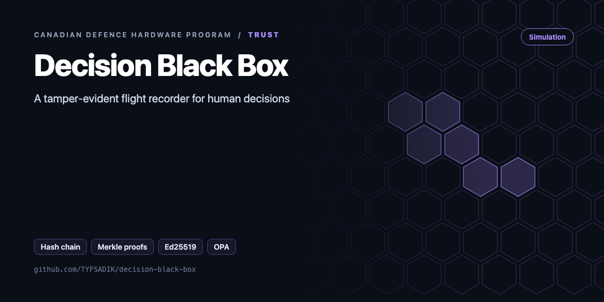
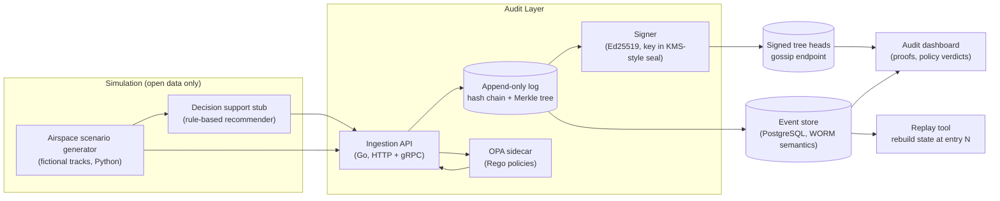

<div align="center">



# Decision Black Box

**Tamper-evident audit layer for human-in-the-loop decisions: hash-chained, signed, append-only log with Merkle proofs, a replay tool, and OPA policy checks.**

[](https://github.com/TYFSADIK/decision-black-box/actions/workflows/tests.yml)   [](LICENSE) [](https://github.com/TYFSADIK/defence-hardware-program)

[Build guide](docs/project-page.md) · [How it works](#how-it-works) · [Quick start](#quick-start) · [Program hub](https://github.com/TYFSADIK/defence-hardware-program)

</div>

## Overview

When a decision support system recommends something and a human approves it, someone has to be able to answer afterwards: what did the operator see, what did the system recommend, which policy version was in force, and who signed off? This project is a **flight recorder for decisions**, built around a fictional airspace-deconfliction simulator. Every recommendation, override, and approval is written to an append-only log that cannot be edited or quietly reordered after the fact.

The core is a **hash-chained, signed log** modelled on certificate transparency (RFC 6962): each entry includes the hash of the previous one, the log operator signs Merkle tree heads, and auditors can request inclusion and consistency proofs. On top of that sit two tools: a **replay engine** that rebuilds the exact state of the simulated airspace picture at any entry in the log, and **OPA policy-as-code checks** that evaluate every decision against the rules of engagement simulated for the scenario (for example: no deconfliction approval without two-operator confirmation).

Why bother: accountability and responsible AI are treated seriously in Canadian defence circles, and DND/CAF has published AI strategy commitments around traceability and human oversight. I wanted to practice the engineering behind those commitments. Everything here runs on simulated data I generate myself. There is no weapons logic, no real targeting information, and nothing classified anywhere in this project.

## How it works



*Simulated sources feed the ingestion API; every event is policy-checked, chained, signed, and stored before it can be replayed or audited.*

## Quick start

```bash
make test      # go vet + race-enabled tests
make demo      # keygen -> append -> verify -> replay -> inclusion proof
opa run --server --addr :8181 policy/    # policy engine
```

Real output from the demo, run on simulated data:

```text
go build -o bin/blackbox ./cmd/blackbox
rm -f /tmp/bb.jsonl && ./bin/blackbox keygen -key /tmp/bbkeys/bb.key
wrote /tmp/bbkeys/bb.key
./bin/blackbox append -key /tmp/bbkeys/bb.key -log /tmp/bb.jsonl -actor op1 -action track.classify -decision uav -inputs '{"track":7,"confidence":0.86}'
seq=1 hash=46b82d36562a51f88a2f0bfdbfb5bdfa2d778e21300deeedb69e91fd9c08dcfd
./bin/blackbox append -key /tmp/bbkeys/bb.key -log /tmp/bb.jsonl -actor op1 -action alert.ack -decision ack -inputs '{"alert":12}'
seq=2 hash=44b60d6611c237b6b1ae4f38ac592a82a8f7562422fba8fc9f1a9a4892bd2df5
./bin/blackbox verify -pub /tmp/bbkeys/bb.pub -log /tmp/bb.jsonl
OK: 2 entries, chain and signatures valid
./bin/blackbox replay -log /tmp/bb.jsonl
   1 2026-10-30T05:33:49Z op1      track.classify           uav        {"track":7,"confidence":0.86}
   2 2026-10-30T05:33:49Z op1      alert.ack                ack        {"alert":12}
./bin/blackbox prove -log /tmp/bb.jsonl -seq 1
{"leaf":"46b82d36562a51f88a2f0bfdbfb5bdfa2d778e21300deeedb69e91fd9c08dcfd","proof":["b25a129a7deb2e0e1d79cabc3fbbb453ff70d1263044aa040b55e91952ede9c9"],"root":"816aa1ce2aae8e72582ab90e63e7e5c8e2b2e7e9a2d7e3b23df67fed2c232c7f","seq":1,"size":2}
```

## What's in this repo

| Path | Purpose |
|---|---|
| `blackbox/entry.go` | Entry format, canonical hashing, Ed25519 signing and verification |
| `blackbox/log.go` | Append-only JSONL log (fsync on every write), chain verification, signed checkpoints |
| `blackbox/merkle.go` | RFC 6962 Merkle tree with audit paths and inclusion verification |
| `blackbox/policy.go` | OPA client that **fails closed**: if the policy engine is unreachable, the action is denied |
| `policy/blackbox.rego`, `policy/data.json` | Role permissions, two-person rule for high-impact actions, confidence threshold, stale-data rule |
| `cmd/blackbox` | CLI: `keygen`, `append`, `verify`, `prove`, `replay`, `checkpoint` |

## What you need

| Category | Item | Notes |
|----|----|----|
| Hardware | Any laptop or desktop | Everything runs in Docker Compose on the homelab |
| Software | Go, PostgreSQL, Open Policy Agent, Python, Docker Compose | Ed25519 via Go x/crypto; RFC 6962 describes the Merkle proof design this follows |
| Skills | Go or Python, SQL, basic Rego for OPA policies, comfort reading an RFC | The Merkle tree is the steepest part; Trillian's design documentation is the best study material |
| Accounts | None | No external services involved; the scenario data is generated locally |

## Status

- **Done**: event schema, append-only PostgreSQL store with insert-time hash chaining, chain rescan verifier, Docker Compose baseline.
- **In progress**: Merkle tree and Ed25519 tree-head signer, inclusion proof endpoint, first OPA policy (two-person approval) on the write path.
- **Next**: consistency proofs and gossip endpoint, seeded scenario simulator, replay CLI, then the audit dashboard.

## Roadmap

- [ ] Keep the signing key in a YubiKey or TPM instead of a file (PKCS#11)
- [ ] Ship checkpoints every N minutes to a second machine. Hash chains prove edits, but only checkpoints prove nothing was cut off the end
- [ ] Replay mode that re-runs the OPA policy recorded in `Policy.Bundle` against the stored inputs
- [ ] HTTP API so `counter-drone-sensor-fusion` and the COP dashboard log every operator decision
- [ ] RFC 3161 timestamping (or Sigstore Rekor on a private instance) for independent time evidence

## Related builds

- [Secure Robot Fleet Updates](https://github.com/TYFSADIK/secure-fleet-updates), signed, measured boot and OTA updates, the integrity companion to audit logging.
- [DDIL-Proof DevOps](https://github.com/TYFSADIK/ddil-proof-devops), the resilient CI/CD pipeline that ships the software this audit layer watches.
- [Zero-Trust Air-Gapped Supply Chain](https://github.com/TYFSADIK/zero-trust-air-gapped-supply-chain), signed artifacts end to end, so the black box records only trustworthy software.

## Learn more

The full build guide, with step-by-step instructions, wiring, troubleshooting and lessons learned, is in [docs/project-page.md](docs/project-page.md). It is also published at [tyfsadik.org](https://tyfsadik.org/work/defence/decision-black-box.html).

## License

[MIT](LICENSE). Built by [Taki Sadik](https://tyfsadik.org) as part of the self-funded [Canadian Defence Hardware Program](https://github.com/TYFSADIK/defence-hardware-program).
